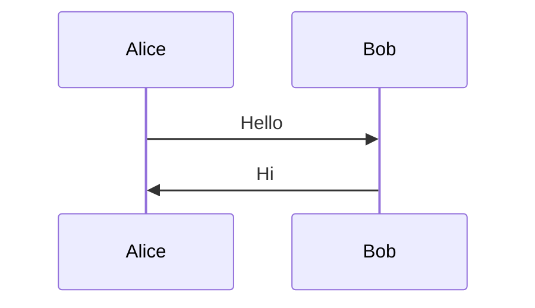
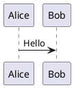

# Slidev Components Reference

Built-in components and the pattern for registering custom ones.

## Built-in components

| Component | Purpose |
|---|---|
| `<Toc />` | Auto-generated table of contents (links to each `<h1>`/`<h2>`) |
| `<TocList />` | Same, list form for inline use |
| `<Youtube id="..." width="..." height="..." />` | Embed a YouTube video |
| `<Tweet id="..." />` | Embed a tweet (uses Twitter's embed JS) |
| `<SlidevVideo>` | Standard `<video>` wrapper with autoplay/loop props |
| `<Arrow x1="..." y1="..." x2="..." y2="..." color="..." width="..." />` | SVG arrow annotation overlaid on the slide |
| `<LightOrDark>` | Conditional render based on `colorSchema` |
| `<RenderWhen context="presenter">` | Show content only in presenter view |
| `<AutoFitText :max="..." :min="...">` | Auto-resize text to fit the container |

## Auto-import

Slidev auto-imports any `.vue` file under `components/` in the project root. No registration needed — drop a file at `components/Foo.vue` and use `<Foo />` in any slide.

## Registering an asciinema player

The `asciinema` skill ships a component snippet at `embed-snippets/slidev.md`. Copy the `<script setup>` block into `components/AsciinemaPlayer.vue` and the component is available everywhere:

```vue
<!-- components/AsciinemaPlayer.vue -->
<script setup lang="ts">
import { onMounted, ref } from 'vue'
import * as AsciinemaPlayer from 'asciinema-player'
import 'asciinema-player/dist/bundle/asciinema-player.css'

const props = defineProps<{
  src: string
  cols?: number
  rows?: number
  autoplay?: boolean
  loop?: boolean
  theme?: string
}>()

const el = ref<HTMLElement | null>(null)

onMounted(() => {
  if (el.value) {
    AsciinemaPlayer.create(props.src, el.value, {
      cols: props.cols ?? 100,
      rows: props.rows ?? 30,
      autoPlay: props.autoplay ?? false,
      loop: props.loop ?? true,
      theme: props.theme ?? 'monokai',
    })
  }
})
</script>

<template><div ref="el" /></template>
```

`npm install asciinema-player` first.

## Monaco editor in code blocks

Slidev embeds Monaco for live code editing:

````markdown
```ts {monaco}
function compute(x: number): number {
  return x * 2;
}
```
````

`{monaco-run}` adds a Run button. Useful for tech talks where the audience can experiment with your code.

## Mermaid diagrams

```markdown


`mermaid` is parsed and rendered natively. No setup required.

## PlantUML

```markdown


Requires the `@slidev/plugin-plantuml` addon: `npm install @slidev/plugin-plantuml`.

## Custom theme components

Themes can ship their own components in `<theme-dir>/components/`. Slidev imports them alongside project-local components. The bundled `slidev-theme-minimal` ships one (`layouts/cover.vue`); add components there if you want them theme-distributable.

## Addon ecosystem

Slidev addons are npm packages that bundle components, layouts, and config. Common ones:

- `@slidev/plugin-plantuml` — PlantUML rendering
- `slidev-addon-graph` — D3/Cytoscape graph rendering
- `slidev-addon-rabbit` — better Japanese typography
- `slidev-addon-asciinema` — pre-built asciinema integration (alternative to the manual component above)

Install with `npm install <package>` and reference in deck frontmatter:

```yaml
addons:
  - slidev-addon-graph
```

For `presentation-kit` v0.2, the manual asciinema component path is the documented one — addons add another moving piece and the manual path is portable across Slidev versions.
